# Voxel Style

The house art style for anything Assembler builds out of parts: creatures, vehicles, props and
buildings. It is voxels — but each **part** sits on its **own grid**, rotated to suit the part, so a
fin, a limb or a roof is a clean angled slab instead of a staircase.

The rules are numbered and normative; each carries a one-line **Why** so an edge case can be decided
by intent rather than by guesswork. Rules marked **[checkable]** can be verified by a program; until
tooling exists, verify them by hand. Everything here is about how a model *looks and moves* — the
file format a model is stored in is deliberately out of scope.

| Doc | Owns |
|---|---|
| [`Models.md`](Models.md) | Composing visuals from the engine's primitive meshes with the `model` behaviour |
| **`VoxelStyle.md`** (this file) | The voxel art style: grids, parts, palette, faces, articulation, buildings, shading |

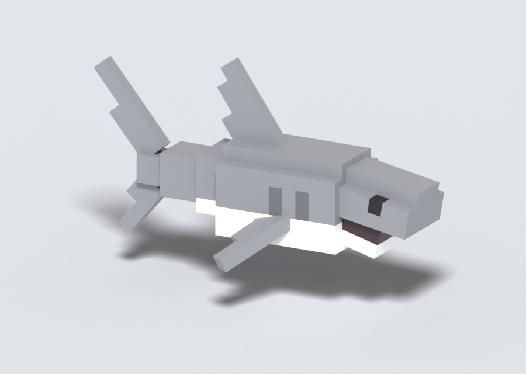

---

## Vocabulary

| Term | Meaning |
|---|---|
| **Voxel** | One cube, 0.1 m on a side. The only unit of size in this style. |
| **Part** | A rigid block of voxels on one grid. Parts are the unit of composition, colour and motion. |
| **Grid** | A part's own voxel lattice: an offset and a rotation relative to the model. |
| **Main grid** | The model's own axis-aligned grid. |
| **Root part** | The one part every other part hangs from — the body, the chassis, the main building mass. |
| **Seam** | Where a part meets the part it attaches to (its **parent**). |
| **Pivot** | The single point a moving part rotates about. |
| **Embedded** | The portion of a part that reaches inside its parent and is never seen. |

---

## 1. Scale and axes

**R1. One unit is one metre; one voxel is 0.1 m, everywhere.** A voxel is the same size on a turtle
as on a house.
*Why:* a single voxel size is what makes every model in the game read as the same material.

**R2. Axes: forward is +Z, up is +Y. The origin is the point the model would turn about in the
game, at ground level** — for anything that stands, the centre between its contact points (the feet
of a biped or quadruped, the wheels of a vehicle, the footpads of a lander). For a subject that
stands on nothing (a swimming shark, a bird in flight) it is the centre of the root part. The origin is defined at the rest pose; a bobbing root leaves it
during the animation.
When authoring in Blender, up is +Z and the front faces −Y; the FBX export (forward −Z, up Y)
converts to Unity's axes.
*Why:* matches [`Models.md`](Models.md) and Unity, and puts the origin where gameplay code will
rotate and place the model.

**R3. Real-world size sets the scale; the reference sets the proportions.** If the model's spec gives
a size, use it. Otherwise size the model from the subject's real size — a ~5 m giraffe is ~50 voxels tall, a 2.4 m shark ~24 voxels long, a person
~18 tall — then shape every part to the reference's proportions within that size. A stubby toy-car
reference stays stubby: the taxi is ~3 m long, not a 4.2 m sedan. The spec may override the
reference's pose or details (an octopus standing on straight tentacles instead of the reference's
sprawl); the reference then supplies character, colour and whatever the spec doesn't replace. Anything meant to read as a
creature or object is at least 12 voxels on its longest side; small subjects are scaled up
toy-style until they clear that floor, and if the reference's proportions need more voxels than the
floor (a 5-voxel head on a 12-voxel shell makes the turtle 19 long), the model gets them.
*Why:* real size keeps models consistent with each other; the reference's proportions are what give
each one its charm — a toy car stretched to real proportions stops being a toy car. Below ~12 voxels
a creature is a smudge.

**R3a. No reference image? Write a design note first, and treat it as the reference.** List the
features that make the subject recognisable, mark which you keep and which you drop (and why), and
state the key proportions as numbers ("roof : wall height 35 : 26", "legs splay 45°"). Everywhere this
document says *the reference*, read *the reference or the design note*; compare the model against the
note, and run the thumbnail test (R7c).
*Why:* without a target there is nothing to iterate against; a written note is a target a generator
can produce, check and be held to.

---

## 2. Parts and grids

**R4. Every part is made of whole voxels and R7b wedges; its dimensions are whole voxels on every
axis. The smallest part is 1 × 1 × 1.** [checkable]
*Why:* whole-voxel parts are what keep this a voxel style rather than free modelling.

**R5. A part's grid may sit on a half-voxel offset — the root included.** A 5-wide snout centres on
the same line as a 6-wide body by shifting half a voxel; a 9-wide body centres on the origin with its
edges at ±4.5. Offsets are measured in the parent's grid; for a rotated part, the point it
rotates about is the one that sits on the half-voxel lattice.
*Why:* lets parts of odd and even widths share a centreline, and is the main tool for satisfying R8.
[checkable: every offset component is a multiple of 0.5 voxel]

**R6. At the rest pose, a part's rotation may be about any axis, in steps of 5°.** Animation is
unconstrained: once the model moves, any angle is fine. [checkable]
*Why:* snapped rest angles keep independently generated parts consistent and make R8 tractable;
snapping motion would only get in the way (a car body pitching 5° is a wheelie).

**R7. A part gets its own rotated grid when its dominant edge is more than 10° off the main axes;
otherwise it stays on the main grid. The root part is never rotated** (it may still take a
half-voxel offset, R5), **and its whole-body motion — a bob, a roll, a sway — pivots about the
origin.**
*Why:* a mechanical threshold a generator can apply; an unrotated root keeps the model square to the
world, and pivoting it about the origin keeps whole-body motion where gameplay already rotates the
model.

**R7a. Prefer slopes to staircases.** Where a form rises, falls or tapers in a run of two or more
steps in the same direction, replace the run with an angled part at a 5° step — usually 45°, and a
45° bevel is always a wedge (R7b). A domed turtle shell is a level top ringed by 45° wedges, not a
stack of shrinking tiers. Single
steps and deliberate tiers may stay: a mixture of slopes and steps is the look. Most models —
creatures, vehicles, anything organic — should have angled parts; a model should be fully
orthogonal only when its subject is (a die, a crate).
- **Silhouette first.** On boxy subjects — vehicles, buildings, props — slopes are few and short,
  used as bevels. A toy car with long slopes everywhere reads as a different, angrier vehicle.
- **Build a slope by tiering, then bevelling.** Step the mass down in tiers and bevel the steps with
  wedges (R7b). Laying an angled slab over a box corner adds bulk instead of cutting the corner away.
- **Small lips and ledges are acceptable.** A slope at an angle other than 45° rarely meets both its
  ends exactly in whole voxels; a lip or notch of up to about half a voxel where it lands is fine. So
  is a half-voxel ledge left on purpose to keep two parts' faces out of one plane (R8) — the
  giraffe's 10-wide tier under its 9-wide back.
- **Form only.** This rule is about shape. Markings (R12) are colour and may step diagonally — a
  triangular window painted in voxels is fine.
*Why:* angled parts are what distinguish this style from plain voxels; a model built only on the
main grid has thrown away the style's main tool — but slopes serve the silhouette, never the
reverse.

**R7b. A 45° bevel is a wedge that exactly fills its corner.** To bevel a k × k corner, notch the
mass k × k and fill the notch with a right-angled wedge whose two legs are k voxels: its sloped face
is exactly k√2 wide and meets both neighbouring faces edge to edge, so the corner reads as one
continuous angled surface. The wedge runs the full width of the surface it bevels, flush with its
sides — never inset, never proud. Its legs and its length are whole voxels.
- **A wedge is merged into the part it bevels**, not a part of its own: it is shape, not structure.
  Merged, it shares no faces with its part and does not count toward R9's cap.
- **Where wedges meet at a corner**, cut both ends on the diagonal so neighbours share an end face and
  the bevel turns the corner continuously (a shell crest, a roof edge). Length is measured along the
  wedge's outer bottom edge.
- **Colour bands and markings stop at the edge of a bevel**; the wedge takes the colour of the faces
  it joins. Where those two faces differ, it takes the colour of the surface it continues — the
  upper one — and the other colour stops at the bevel.
- **A round part** — a wheel, a dish — is one square slab with all four corners bevelled this way:
  an octagon, every piece the same thickness. A dish may recess its centre. Use round parts only
  where the roundness survives the thumbnail test (R7c): things that spin, and round outlines that
  face the camera and define the subject. Everything else stays square.
- **Bevelled openings** — the inside corners of a hole bevelled into an octagon window or a
  round-topped door — are allowed on holes that go right through, and should be rare: a square
  opening usually carries the same character (see Taste calls). A door leaf's bevel matches its
  opening's.

[checkable: a wedge's legs equal its notch; its length equals the bevelled edge]
*Why:* a rotated box cannot fill a corner — a whole-voxel slab is either too long or too short for
the k√2 diagonal, so its ends poke out past the faces it should meet or stop short of them, and an
inset slab leaves a step at each side. A wedge sized to its corner is indistinguishable from a
bevelled surface.

**R7c. Keep only what survives the thumbnail test.** Render the model (not the frame) about 80
pixels tall from the thumbnail camera — a three-quarter view from the front-left, 30° above the
horizon. A feature stays only if it changes the silhouette at that size or is part of what makes the
subject recognisable; otherwise simplify it to the simplest shape that still passes
(square beats octagon, no lip beats a lip) or drop it. Small insets, lips, trims and roundings go,
even when the reference shows them.
- A feature *reads* if its smaller dimension is at least 3 pixels in the thumbnail. Eyes are exempt:
  they always stay, at the size R13 gives them.
- A round part earns an octagon only if it is at least 8 voxels across; smaller, it is square.
- Parts another rule requires (a ridge cap, R21) stay, in their simplest form; the test strips
  optional detail only.
*Why:* detail the player can't see costs parts, colours and checks, and makes generated models look
fussy. The test turns "too much detail" from taste into something a generator can run. Where it
cannot decide, the [Taste calls](#taste-calls) are precedent.

**R8. Overlapping parts must not share a face plane — in any pose — unless the coinciding faces are
the same colour.** Coincident faces of *different* colours flicker in the game. Separate them by
giving the parts different widths, a half-voxel offset (R5) or a different angle. In practice a child
part usually needs a half-voxel offset or a width different from its parent: treat that as the
default, not the exception — and choose widths across the whole model, not just child against
parent, since unrelated parts collide too. Check the rest pose, every frame of every animation, and
each moving part at the instant it passes back through its rest angle — wherever that falls in the
cycle, even between frames. At that instant its faces can line up exactly with its parent's; a hair
either side they don't, so a check that only samples frames can pass by luck. A part that dwells at
its rest angle (a hip through a whole stance) is checked throughout. [checkable]
The same-colour exemption covers only parts that bake their AO as one group (R24) — parts that
never move relative to each other. Parts that move relative to each other carry different baked AO,
so even same-colour coincident faces flicker between them: moving parts never share a plane where
either face can be seen. Faces that can never be seen are exempt — two segment ends pressed together
at a straight knee, or sibling parts overlapping in their buried portions inside a parent.
*Why:* this was the most frequent artefact while developing the style — snout against jaw, tail
stalk against body, an octopus's knees. Offline renderers (Blender's Cycles) show any coincident
faces as black, so previews may look wrong where the game will not.

**R9. At most 32 parts per creature, vehicle or prop.** Buildings are unlimited, but every distinct
roof plane counts as one part.
*Why:* a cap forces simplification — an octopus gets fewer, chunkier tentacle segments, which suits
the style.

---

## 3. Colour and finish

**R10. Every colour comes from the [shared palette](#palette).** [checkable]
*Why:* one palette is what makes separately generated models sit together in one scene.

**R11. At most 6 palette colours per model — eyes and mouth included.** Using a neighbouring shade
from the same family to separate forms the reference shows in one colour (a shell rim from its
shell) is encouraged; it still counts toward the six. [checkable]
*Why:* few colours read as designed; many read as noise.

**R12. Flat matte colour, one colour per voxel. No textures, gradients, soft bevels or outlines.**
Markings — spots, patches, stripes, a checker band — are recoloured voxels within a part. That is
not a texture; they count toward R11's six colours.
*Why:* the silhouette and the angled planes carry the form; surface treatment fights them.

---

## 4. Faces

**R13. Every creature has square eyes, in Ink (P08), sized by its head: 1 × 1 when the head is
under 8 voxels tall, 2 × 2 when it is 8 or more.** Eyes are never slits, even when the reference
shows them, and never sized up to clear the thumbnail threshold — on a tall model a 1 × 1 eye is
tiny in the thumbnail, and that is right (see Taste calls). Eyes are recoloured voxels of the head part, not parts of their own, so they move with it. A
mouth (R14) is Mouth (P07).
*Why:* missing eyes was the most common failure across the test models; a creature without them
reads as an object.

**R14. A mouth is optional, and is a dark row on a hinged jaw part** (see R19). Only creatures whose
silhouette has a jaw get one.
*Why:* a jaw row reads as a closed mouth at rest and a gape when it opens, with no extra parts.

---

## 5. Articulation

Parts exist so they can move. Every rule here came from an artefact: necks that detached, seams that
went black, a tail that floated, a jaw that clipped.

**R15. A moving part must never show a gap at its seam — anywhere in its range of motion.** Achieve
it by letting the part reach inside its parent: the embedded portion is never seen at rest, and
fills what would otherwise open up as the part turns. How deep is whatever works; one voxel is the
usual starting point. A gap means daylight through the joint: test that the child's buried end
stays inside the parent in every pose, including both extremes of the motion, *and* that no light
passes between the two parts. Side faces turning out of the parent as the part swings are expected,
not a gap; so is a small notch on the outside of a bend between two limbs of equal width (R17) —
an opening only on the outside of the bend, with no hole through the joint seen from any side.
[checkable]
*Why:* a part that merely touches its parent visibly detaches the moment it rotates.

**R16. A moving part only rotates, about one fixed pivot placed where the real joint would be — a
hip, a shoulder, the base of a neck, a hinge edge, an axle — on or inside its parent.** It never
moves its position relative to its parent, and its pivot is never in empty space. Only the root may
move as a whole (R7). A part's grid placement (R5) and its pivot are independent — don't force them
to coincide. Pivot rules apply to moving parts only; a part that never moves may anchor wherever
keeps its grid on the lattice. [checkable: the pivot is fixed and on or inside the parent]
*Why:* a pivot off the parent makes the part slide across the seam and look "floaty"; a pivot where
the real joint is keeps it attached, swings it the way the eye expects (a door on its hinge edge
opens to 85°; on its centre it jams at 45°), and makes R8 provable.

**Ground contact.** In an in-place walk, the root bobs so the lowest foot always touches the ground:
a leg that swings about its hip otherwise pushes its sole below it. Feet sliding along the ground is
fine — that cartoony walk is part of the look. Where a foot must visibly lift, make the leg a chain
of two parts (thigh and shin), each rotating about its own seam pivot; R16 already allows chains.

**Vehicles.** Wheels hang from the body, so any bob or pitch of the body lifts them: keep it slight,
with the lower axle on the ground. A lift of up to about half a voxel is invisible at game scale.
There is no suspension. Things that fly or land (a lander, a bird) may hover clear of the ground;
their rest pose is the touchdown pose.

**Cycle speed.** Smaller subjects move faster. A locomotion loop (walk, waddle, swim, crawl) lasts
**frames = round(24 × √L)** at 24 fps, where **L** is the *real* subject's longest dimension in
metres — not the model's, which R3 may have scaled up. A goose (0.8 m) waddles in 21 frames, an
octopus (0.8 m) crawls in 21, a shark (2.4 m) swims in 37, a moose (3 m) walks in 42, a giraffe
(5 m) in 54. Character may override it: a turtle is slower than its size suggests. Rounding to a
nearby count that puts a gait's phases on whole frames is fine — the octopus's two-group crawl uses
20 (divisible by 4) rather than 21.

**Loops.** Every animation loops seamlessly: the last key equals the first, with cyclic or linear
interpolation at the seam, so the loop doesn't hitch.
*Why:* a small animal on a big animal's cycle looks floaty — the goose did, on the shark's 36 frames.

**R17. A moving part either narrows into its parent, or matches its width with a hidden tenon and
a diagonal hinge.**
- **Narrowing** (the default for tails, necks, stalks): the child sits inside the parent's
  cross-section — a 3 × 3 tail stalk enters a 4 × 4 body rear, on a half-voxel offset (R5).
- **Constant width** (limbs that should read as one even width, like an octopus's tentacles): the two
  segments meet end to end with the pivot at the centre of the join; only the child's buried portion
  is narrower — a tenon, e.g. a 1 × 1 stub inside 2 × 2 segments — so it fills the joint as it bends.
  The hinge axis must run diagonally to the limb's faces, never parallel to a pair of them, or those
  faces stay coplanar through the bend and flicker. A small notch on the outside of the bend is
  accepted (R15).

*Why:* a child the same size as its parent shares its planes, which turning cannot separate — an R8
failure on every frame. The octopus's side tentacles, hinged parallel to their faces, flickered at
every bent knee; its corner tentacles, hinged diagonally, never did.

**R18. Any hierarchy is fine, while building and in the export, as long as the animation plays
correctly in Unity.** Verify it there, not in the authoring tool.
*Why:* only the result in the game matters. Caution: nested parts have come back rotated or
misplaced through the FBX export before; if that happens, flatten — every part a direct child of the
root, with chained motion baked into each part's own animation.

**R19. A jaw shares its hinge line with the head, at the mouth corner, and rests one 5° step further
open than the head's own pitch. Opening only rotates it further away.**
*Why:* at the head's exact pitch the two slabs would touch face-to-face (R8); one step open leaves a
thin dark mouth line, and rotating away from the head can never clip into it.

---

## 6. Buildings

**R20. Real-world building dimensions, in whole voxels:**

| Element | Voxels | Metres |
|---|---|---|
| Wall thickness | 2 | 0.2 |
| Storey, floor to floor | 30 | 3.0 |
| Floor slab | 2 | 0.2 |
| Door opening | 10 × 21 | 1.0 × 2.1 |
| Window sill height | 9 | 0.9 |

*Why:* a person is 18 voxels tall (R3); these are the sizes that make a building usable at that
scale.

**R21. Each roof plane is one part, on a grid rotated to the roof pitch, 2 voxels thick.**
- **Ridge.** Two planes meet cleanly only at 45°; above that, both planes' top ends poke past each
  other, so a pitch steeper than 45° needs a ridge cap on the main grid.
- **Gables.** A gable wall on the main grid steps up under the roof; bury every step inside the roof
  plane's thickness, so no step shows and R7a is not broken.
- **Kinks.** Where two planes of different pitch meet (a flared eave), the upper plane runs one voxel
  past the joint, and the two planes differ in width so their end faces don't coincide. Parent the
  lower plane to the upper one, so the joint lands on whole voxels in its grid (R5).

*Why:* the same move as a fin — a clean slope instead of a staircase — with the joins the first real
roof needed.

**R22. Buildings are enterable: floors, internal walls and stairs. Furniture is props, and follows
the prop rules.** A door is a leaf one voxel larger than its opening at each side and the top,
hung on the inside face of the wall, hinged on its edge (R16), opening at most to one 5° step short
of flat against the wall — 85°.
*Why:* the building owns its structure; everything you could pick up or move is a prop.

---

## 7. Shading

Flat palette colour (R12) plus ambient occlusion baked once, offline, into the mesh — real occlusion
from a path tracer, free at runtime. The bake has to stay believable while parts move, which is what
these rules are for.

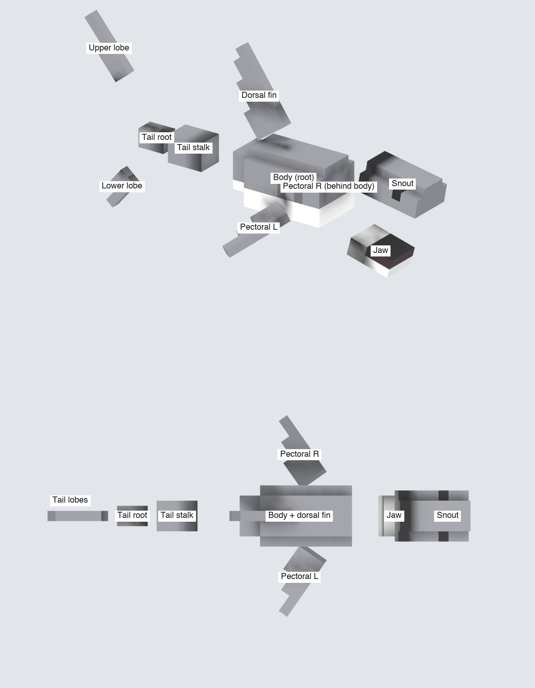

**R23. Bake AO offline into a dedicated vertex channel, per face corner; palette colours stay
untouched.** Use Blender Cycles' AO bake into a colour attribute named `AO` in the face-corner
domain, so faces keep hard edges. The game shader multiplies base colour by it. Keep the AO reach
short — about **2 voxels** — and leave the ground out of the bake (where a model stands is not known
in advance). Subdivide large faces — every wedge face — to one segment per voxel before baking, so
the AO has the same detail everywhere. [checkable: every mesh carries an `AO` channel]
*Why:* real occlusion at no runtime cost; a separate channel keeps palette colours exact and the
strength tunable; a short reach keeps contact shading close to the seams, where pivots (R16) keep it
nearly still.

**R24. Bake each part with only itself, its parent and its children visible, averaged over the
animation.** Parts that never move relative to each other (a body's bumpers, its cabin, its roof
sign) bake as one group. Spread the poses across each part's motion *relative to its parent* — for a
spin, across its angle of symmetry — and sample often enough to catch the extremes of the fastest
motion: at least 6 poses, more for motions that peak twice per cycle. Poses may fall between frames
(a 54-frame walk's quarter points are half frames), and extremes that fall between samples are
acceptable. When every child is a big mover (R25) the parent bakes alone — legal, and its AO is only
its own creases. Bake the part at each pose with its neighbours present, and average. This
one bake carries three layers:
- **self-occlusion** — a rigid part's own creases, correct in every pose;
- **seam contact** — the parent darkening the child where it enters, which barely moves because the
  pivot is on the seam;
- **averaged contact** — a moving child's shadow on its parent, smeared over the child's range so it
  never shows a hard gap or a shadow left behind.
*Why:* a single rest-pose bake goes stale as parts move — an opened jaw keeps the darkness of being
shut. Averaging trades a slightly soft contact for one that is never wrong.

**R25. Big movers never darken their parent.** Big movers are jaws, striding legs, doors and hinged
lids. Anything that sways, spins, pans or twitches is not — fins, tails, heads, wings, dishes,
wheels. Leave a big mover out of its parent's bake (R24) — its own
seam contact is kept.
*Why:* a contact shadow that has to cover a large sweep becomes a dark smear across the parent; a
missing one is never noticed.

**R26. A model that does not animate bakes once, at rest, with every part present.**
*Why:* with no motion there is nothing to go stale; the full bake is the most accurate.

Embedded portions (R15) bake almost black. That is correct — they are never seen.

---

## Palette

64 colours in thirteen families, each family listed light to dark, so every hue has a neighbouring
shade to separate forms with (R11). Pick by family ("wood", "roof", "purple"), then by shade.
Indices are permanent — models refer to them — so colours added later take the next free number
rather than renumbering; that is why the numbers within a family are not always consecutive. Tune
the hex values freely.

| Family | Light → dark |
|---|---|
| **Neutrals** | P00 White `#f6f6f2` · P01 Pale grey `#dcdcd8` · P02 Light grey `#b2b2b2` · P63 Steel `#8896a8` · P03 Grey `#8a8b90` · P04 Slate `#66676c` · P05 Charcoal `#4a4a50` · P06 Graphite `#2b2b30` |
| **Features** | P07 Mouth `#3a2630` · P08 Ink `#141414` |
| **Skin** | P60 Light skin `#f2d0b0` · P61 Mid skin `#c88a60` · P62 Dark skin `#6e4428` |
| **Fur & earth** | P09 Cream `#ece0c0` · P10 Sand `#dcc08e` · P11 Fawn `#c49470` · P12 Tan `#b07a50` · P13 Chestnut `#8e5634` · P14 Brown `#6e3d22` · P15 Dark brown `#4a2818` · P16 Umber `#2e1810` |
| **Foliage** | P59 Mint `#b8e6b0` · P17 Lime `#a6ee28` · P18 Sage `#bcc584` · P19 Leaf `#8fc23a` · P20 Olive `#9ea26a` · P21 Grass `#5a9440` · P22 Forest `#3b7038` · P23 Pine `#23452a` |
| **Wood** | P24 Pale wood `#c89a60` · P25 Oak `#9a6a3a` · P26 Walnut `#6b4528` · P27 Dark wood `#4a3020` |
| **Stone & brick** | P28 Limestone `#b8b0a4` · P29 Stone `#8a837a` · P30 Dark stone `#5c5650` · P31 Brick `#b5543a` · P32 Dark brick `#8a3a28` |
| **Roof** | P33 Terracotta `#9c4a36` · P34 Dark tile `#6a2e2a` · P35 Slate roof `#4a5260` |
| **Glass & water** | P36 Glass `#cfe6f2` · P58 Aqua `#7ad0c8` · P37 Sky `#8ab4d8` · P57 Teal `#2a8a8a` · P38 Water `#2f7fa8` · P39 Blue `#4a66b4` · P40 Deep blue `#3a4d8c` · P56 Navy `#23305a` |
| **Yellows** | P41 Butter `#ffd070` · P42 Yellow `#f6d021` · P52 Gold `#c8961a` |
| **Oranges** | P50 Peach `#f6b48a` · P43 Amber `#eea62a` · P44 Orange `#f08236` · P51 Rust `#b4521e` |
| **Reds & pinks** | P53 Blush `#f6c4cc` · P46 Pink `#e8899a` · P54 Rose `#b84a64` · P45 Red `#c83a2a` · P49 Dark red `#8c2520` |
| **Purples** | P55 Lavender `#d4b0e0` · P47 Purple `#b868c0` · P48 Plum `#7a3e86` |

---

## Taste calls

Decisions from reviews that the rules alone didn't settle. Treat them as precedent: when a choice is
close, do what these did. Every review that makes a call adds one here.

| Model | Rejected | Chosen | Why |
|---|---|---|---|
| Taxi | Real 4.2 m proportions with long slopes on bonnet, windscreen and boot | The toy reference's stubby proportions with four short bevels | Long slopes turned a cute toy car into an angular, aggressive one (R3, R7a) |
| Lander | Octagonal footpads | Square footpads | Seen from the game camera the pads are edge-on; their roundness never shows (R7c) |
| Goose | A one-voxel lip around the top of the body, copied from the reference | A plain body | The lip isn't part of what makes it a goose (R7c) |
| Cottage | Octagon window and round-topped door as bevelled openings | Square openings | The house has exactly the same character either way; the bevels were cost without gain (R7b) |
| Turtle | Shell as a stack of shrinking tiers | Level crest ringed by mitred 45° wedges | The staircase was the one place the reference read as stepped rather than shaped (R7a, R7b) |
| Moose | Antler palms rolled outward 15° | Flat palms on the main grid | The roll read as a reindeer |
| Goose | 2 × 1 slit eyes | 1 × 1 square eyes | Slits read as evil; square eyes keep creatures friendly (R13) |
| Giraffe | Eyes enlarged to clear the thumbnail threshold | 1 × 1 eyes, sized by the head | Oversized eyes made it cartoonish; eye size follows the head, not the thumbnail (R13) |
| Octopus | Tentacles sprawled as in the reference | Eight straight tentacles, two joints each | Readable and animatable; the sprawl couldn't walk (R3) |
| Octopus | Tentacles tapering from 2 × 2 to 1 × 1 | Constant 2 × 2 with a hidden tenon | An even width reads as one limb; the taper read as a stick on a block (R17) |
| Cottage | Chimney leaning 5° with a further 5° cap | One stack leaning 10° | Same crookedness, one part fewer; the cap didn't survive the thumbnail (R7c) |

---

## Method

The order that has worked, as a guide rather than a rule:

1. **Silhouette first.** Block the root part on the main grid at real size (R1–R3); with no
   reference, write the design note first (R3a). Get the outline right before anything else.
2. **Split off everything diagonal.** Any part whose main edge leans more than 10° (R7) becomes its
   own part, rotated in 5° steps (R6), with its embedded portion reaching into its parent (R15).
   Then look for staircases — any run of two or more steps — and turn them into slopes (R7a).
3. **Place every moving part's pivot at its real joint** (R16). Parts that never move need no pivot.
4. **Separate coincident planes** with widths and half-voxel offsets (R5, R8, R17).
5. **Colour from the palette** (R10–R12), then eyes (R13) and, if it has a jaw, a mouth (R14, R19).
   Then run the thumbnail test (R7c) and strip what doesn't survive.
6. **Animate, then re-check R8 and R15 on every frame**, not just the rest pose — and confirm the
   animation plays in Unity (R18).
7. **Bake AO last** (R23–R26), once the shape and the animation are final: any change to either
   invalidates the bake.

---

## Examples

Nine models built while the style was developed — follow them. Each exercises a different part of
the style: the shark rotated grids and a jaw, the turtle wedges on a creature, the taxi wedges and
wheels on a boxy subject, the lander working without a reference, the cottage the building rules,
the giraffe a tall subject at real size, the moose antlers and a mixed-colour bevel, the goose the
detail budget and a fast cycle, the octopus a pose that overrides its reference and constant-width
limbs. Each example ends with its **taste** — the judgement calls the rules didn't decide, and why.

Previews are lit directly with the baked AO multiplied in (R23) — the closest stand-in for how the
game shows them — except the shark's, which are path-traced; its baked AO is in the
[Shading](#7-shading) section.

### Shark — rotated grids, a jaw and a swim chain

Ten parts, five colours (Grey P03, White P00, Ink P08, Slate P04, Mouth P07), ~24 voxels long.
Every rotation is a multiple of 5°; every offset a multiple of half a voxel; every moving part pivots
on its parent's seam.

| Part | Grid | Size (W × L × H voxels) | Placement | Notes |
|---|---|---|---|---|
| Body | main (root) | 6 × 11 × 6 | origin | Top row inset; rear two rows narrow to 4 × 4; belly rows White; gills Slate |
| Snout | offset ½ in X, pitched 10° nose-down | 5 × 7 × 3 | hinged at the head seam | 2 rows embedded in the body; eyes 1 × 1 Ink (head is 5 tall, R13) |
| Jaw | pitched 15° | 4 × 5 × 2 | same hinge line as the snout | Top front row Mouth; opens 15° → 35° (R19) |
| Dorsal fin | offset ½ in X, swept back 35° | 1 × 4 × 9, tapering 4-3-2-1 | base embedded in the body | Straight leading edge; the taper steps only on the trailing edge |
| Tail stalk | offset ½ in X and Z, main angle | 3 × 4 × 3 | pivots on the body's rear face | Sits inside the body's 4 × 4 rear (R17) |
| Tail root | main | 2 × 3 × 2 | pivots on the stalk's end face | Reaches one voxel back into the stalk (R15) |
| Upper lobe | swept back 40° | 1 × 2 × 7 | rigid with the tail root | Hinged above the root so it never overlaps the lower lobe (R8) |
| Lower lobe | swept down-back 40° | 1 × 2 × 4 | rigid with the tail root | Hinged below the root |
| Pectoral fins ×2 | swept 35°, drooped 25° | 7 × 3 × 1, tapering 3-2-1 | pivot inside the body | One voxel embedded |

| Side | Top |
|---|---|
| 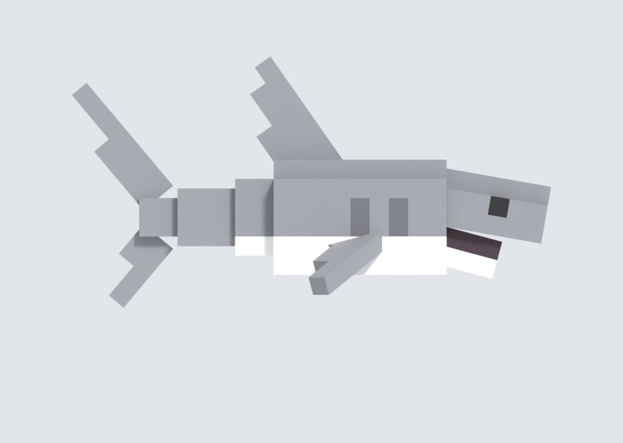 | 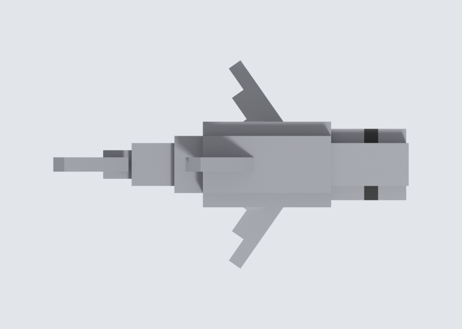 |

**Swim cycle.** A wave runs head to tail through a chain of seam pivots: the body sways 4° and bobs;
the head counter-sways 3°; the stalk follows at 13°, the tail at 20°, each a little later than the
one in front; the pectorals flap; the jaw opens once per cycle.

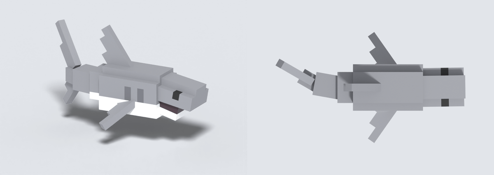

**Taste.** The snout and jaw tilt toward each other so the nose reads as a wedge without a single
bevel. The fins are straight angled strips — clean leading edges, tapering only on the trailing
edge — because a shark is recognised by its fin outlines. The tail lobes were cut down from a first
version that dominated the body: at 7 and 4 voxels they balance the dorsal fin. The belly is White
against Grey for the countershading every shark has, and the mouth is a single dark row (R14).

### Turtle — a stepped reference, softened with wedges

The reference is plain stacked voxels. The model keeps its blocky character — a cube head, square
legs, a stepped rim — and replaces only the staircase at the top of the shell with a bevel (R7a):
a level crest ringed by four 45° wedges, mitred where they meet (R7b). That is the mix the style is
after: slopes where the reference staircases, steps where it is deliberately tiered.

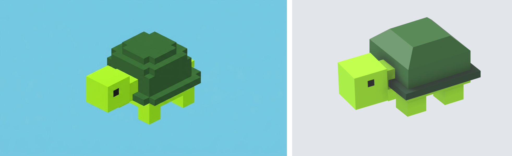

12 × 19 × 10 voxels — a 0.3 m animal scaled up past the 12-voxel floor, and to 19 long because its
head and shell need it (R3). Four colours: Lime P17, Forest P22, Pine P23 (the rim, a neighbouring
shade to separate it from the shell, R11), Ink P08.

| Part | Grid | Size (W × L × H voxels) | Pivot | Notes |
|---|---|---|---|---|
| Shell | main (root) | 12 × 12 × 7 | origin, centre between the feet (R2) | Lime underside, Pine rim, Forest block; 6 × 6 crest |
| Crest wedges ×4 | main, merged into the shell | legs 2 × 2, length 10 | — | Fill 2 × 2 notches along each crest edge; ends mitred so the bevel turns the corners |
| Legs ×4 | offset ½ in Y | 3 × 3 × 5, 2 embedded | centre of each hip on the shell's underside | Spaced so their inner faces never meet the neck's planes (R8) |
| Head | offset ½ in X, Y and Z | 5 × 8 × 5 (head and neck) | centre of the neck where it enters the shell | Eyes 1 × 1 Ink |
| Tail | offset ½ in X, Y and Z | 1 × 4 × 1 | centre of the tail where it enters the rim | |

**Walk.** Legs swing ±20° in diagonal pairs, the head turns ±10° and nods ±5°, the tail wags ±20°.
The shell bobs so the lowest sole always touches the ground; the feet slide — the cartoony walk.
**AO:** the legs are big movers (R25) and leave the shell out of their shadow; head and tail sway, so
their contact is averaged into the shell (R24).

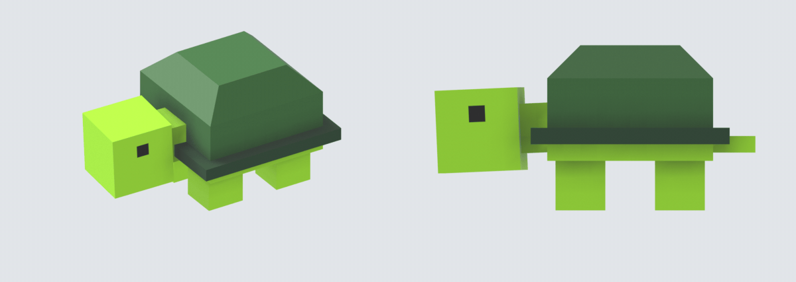

### Taxi — a boxy subject, bevels and wheels

The style's hardest case for charm: an earlier attempt at real car proportions (4.2 m) with long
slopes everywhere read as a different, angrier vehicle. This one takes its proportions from the toy
reference (R3) and uses slopes only as four short bevels (R7a), so the silhouette stays a cute boxy
toy.

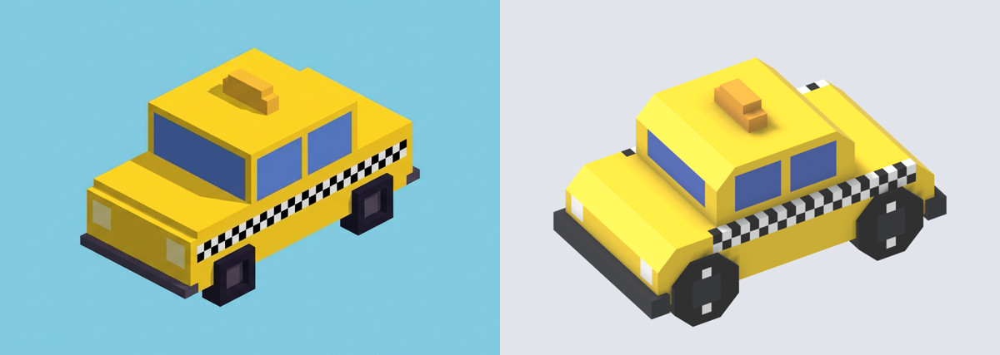

~3 m long: 30-voxel body, 32 with bumpers, 18 wide at the wheels. Nine parts, six colours — Yellow
P42, Ink P08, White P00, Graphite P06, Blue P39, Amber P43 — the cap exactly (R11). The checker band
and windows are markings (R12) and stop short of every bevel (R7b).

| Part | Grid | Size (W × L × H voxels) | Pivot | Notes |
|---|---|---|---|---|
| Chassis | main (root) | 16 × 30 × 6 | origin, centre of the wheels (R2) | Nose and boot bevelled by 2 × 2 wedges, 16 long — the full chassis width, flush with its sides |
| Cabin | main | 14 × 15 × 7 | — | Roof front and rear bevelled by 2 × 2 wedges, 14 long; windscreen and windows are Blue markings |
| Bumpers ×2 | offset ½ in X and Z | 17 × 2 × 2 | — | One voxel embedded |
| Roof sign | offset ½ in Z | 6 × 2 × 3, stepped | — | |
| Wheels ×4 | main | 2 × 7 × 7 octagon | on the axle, where it crosses the flank (R16) | One slab, four corners bevelled by Ink wedges (R7b); Graphite hub with a White bar so the spin reads |

**Drive.** Each wheel turns twice per loop, a whole number of turns so the loop is seamless. The body
pitches ±1° and bobs to keep the lower axle on the ground (Vehicles note). **AO:** the body parts
never move relative to each other and bake as one group (R24); a spinning octagon's contact is the
same at every angle, so the wheels are not big movers.

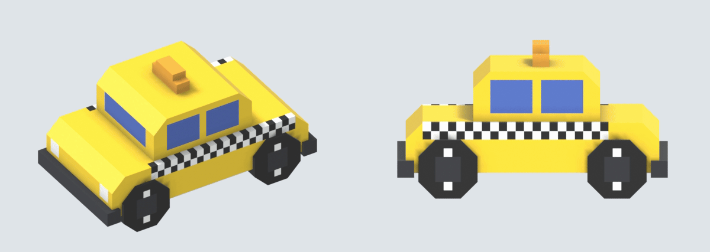

### Lunar lander — no reference, a design note instead

Built from a text prompt alone ("an Apollo lunar module"), so a design note stood in for the
reference (R3a): the recognisable features kept and dropped, and the key proportions as numbers —
67 tall to 94 across the footpads, legs splayed exactly 45°, descent to ascent stage height 17 : 27.
The thumbnail test (R7c) then stripped the engine bell to a block, the docking tunnel to a box, and
the footpads from octagons to squares (see Taste calls). The two dishes keep their octagons: they face
the camera and read as round.

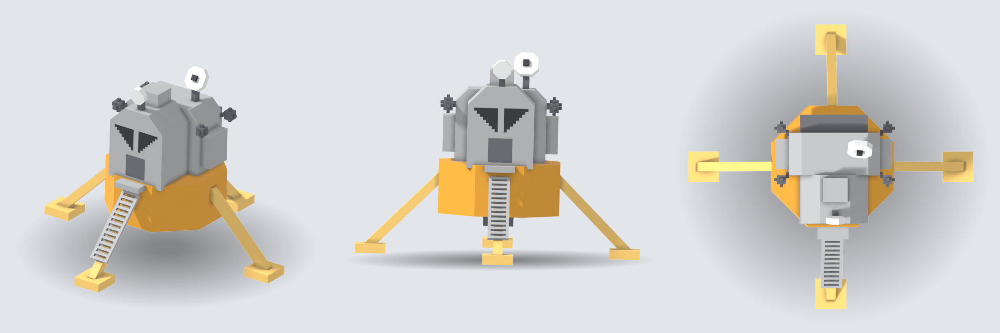

Thirteen parts, six colours — Amber P43 (descent stage), Butter P41 (legs), Light grey P02 (ascent
stage), Slate P04, Graphite P06 (windows), White P00 (dishes). The descent stage is an octagon of 45°
wedges (R7b); the legs are rotated-grid struts; the faceted ascent stage mixes wedges and steps.

**Idle.** It hovers just above the ground (Vehicles note) with a slow circular wobble about the origin
— the centre of its four footpads (R2) — while the S-band dish pans ±30° and the radar nods, each on
its mount (R16). Nothing on it is a big mover (R25).

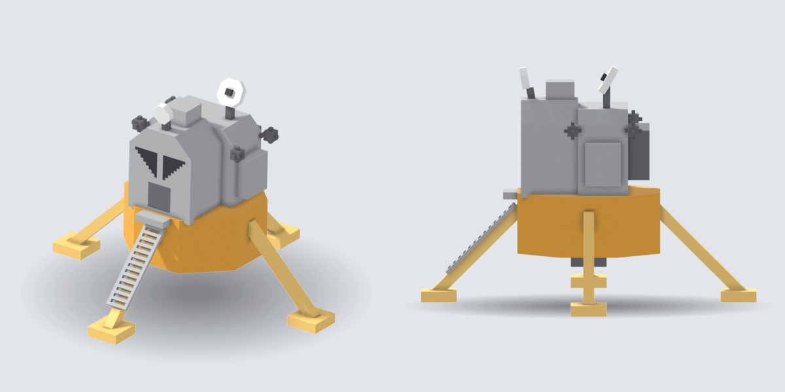

### Cottage — a building

The building rules (R20–R22) on a fairy-tale cottage, also from a design note. The charm is all
proportion and crookedness: a roof bigger than the walls (35 : 26), pitched 60° with a 45° flare at
the eaves, a chimney leaning 10°, one shutter hanging askew by 10°. Openings are plain rectangles
(see Taste calls).

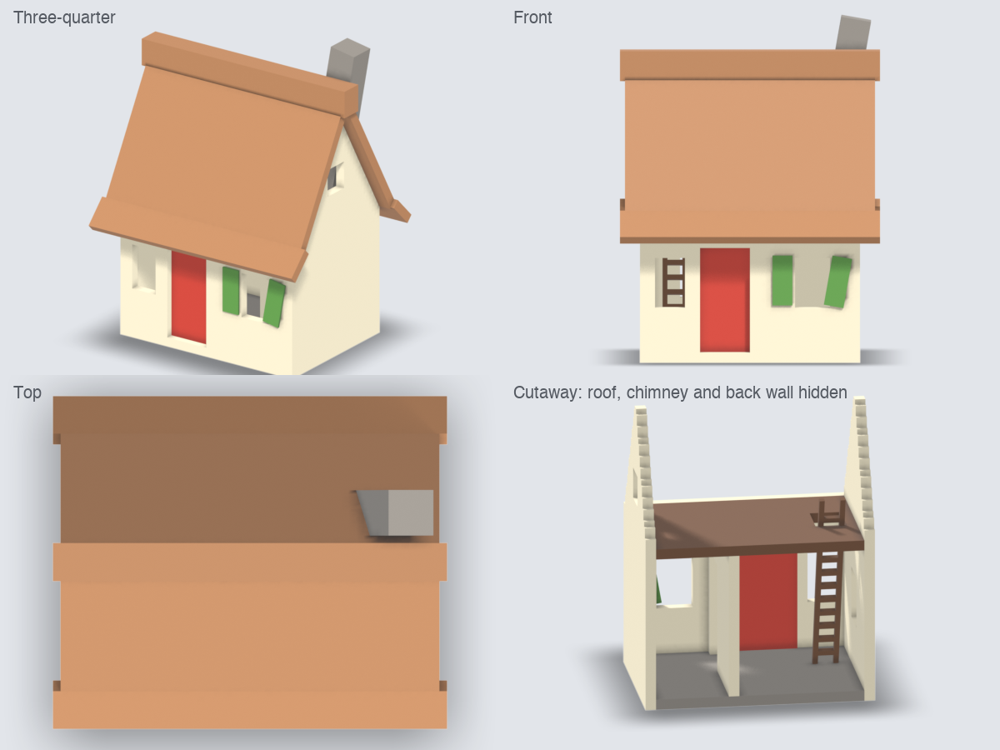

5.2 × 4.4 × 7 m, six colours — Cream P09, Tan P12 (thatch), Walnut P26, Stone P29, Red P45 (door),
Grass P21 (shutters). The roof follows R21: a ridge cap because the pitch is above 45°, gable steps
buried in the roof planes, and each flare parented to its upper plane and running a voxel past the
kink. Inside: an internal wall, a loft floor and a ladder (R22).

**Door.** The only moving part: a leaf a voxel larger than its opening, hung on the inside face and
hinged on its edge, swinging to 85° and back (R22). It is a big mover, so the house bakes its AO
without it (R25).

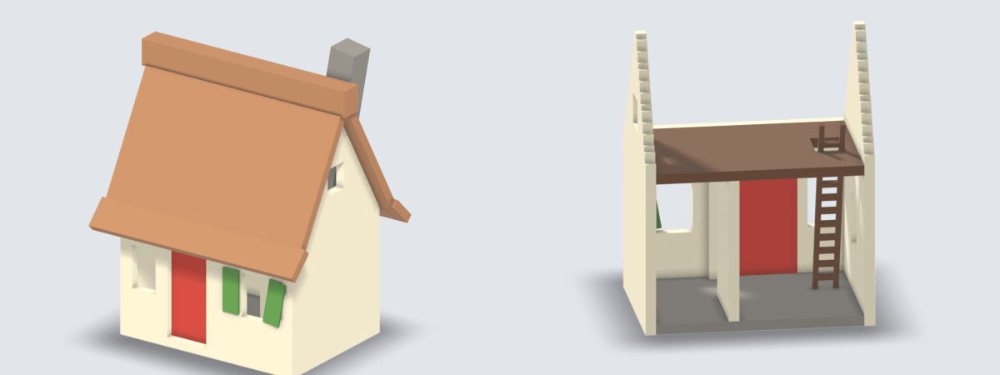

### Giraffe — a tall subject at real size

Built at real size: 55 voxels (5.5 m) tall, so each voxel is under 2 pixels in the thumbnail and the
detail budget is tight. Thirteen parts, four colours — Butter P41 (coat), Chestnut P13 (patches),
Brown P14 (muzzle, hooves, ossicone tips), Ink P08 (eyes).

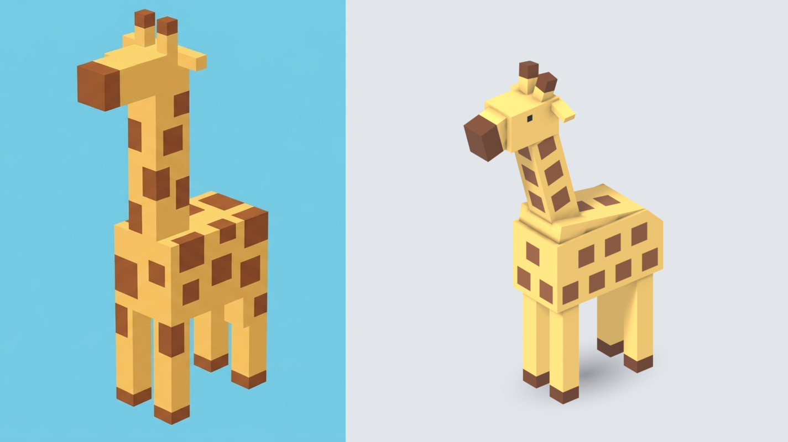

| Part | Grid | Size (W × L × H voxels) | Pivot |
|---|---|---|---|
| Body | main (root) | 10 × 20 × 11, rear-top corner bevelled by a 3 × 3 wedge the full width | origin, centre of the four feet |
| Back | offset ½ in X, pitched 10° | 9 × 16 × 6 | — (rigid with the body) |
| Legs ×4 | main | 3 × 3 × 19, 3 buried | shoulder and hip, 3 voxels up inside the body (R16) |
| Neck | offset ½ in X, leaning 15° forward | 5 × 5 × 24, 5 buried | where its axis meets the back's top |
| Head | main | 6 × 9 × 6, eyes 1 × 1 (head under 8 tall, R13) | centre of the neck's top |
| Muzzle, ossicones ×2, ears ×2 | pitched 15°; leaning 10°; drooping 20° | 4 × 6 × 5; 2 × 2 × 5; 4 × 2 × 1 | — (rigid with the head) |

**Walk.** 54 frames (cycle speed, 5 m). It paces — both legs on one side swing together, ±20° — the
neck nods with each step and sways once a stride, and the head counter-nods to stay level. The legs
are big movers (R25); the neck's contact is averaged into the body.

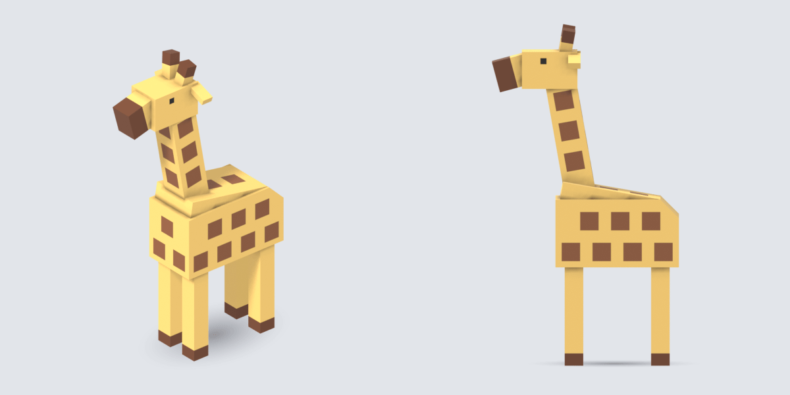

**Taste.**
- **The rump is a tier and a wedge, not a raised back.** The 10° back sits on top and the wedge only
  bevels the rear corner, so the back rises out of the rump instead of sitting on a plain box.
- **A half-voxel ledge along each side** where the 10-wide tier meets the 9-wide back keeps their
  faces out of one plane (R7a, R8).
- **Patches are 3 × 3 squares in staggered rows, one voxel in from every edge** — the patches make it
  a giraffe, and the margin stops one-voxel slivers wrapping corners, which read as noise. The neck
  gets one patch column per face, staggered face to face.
- **Plain legs**: a patch on a 3-wide leg is either a sliver or under 3 pixels.
- **Pace, not trot**: giraffes really do move both legs on a side together, so it reads as a giraffe
  rather than a horse — and with hips at the real joint, a trot would collide the legs.
- **The neck nods once per step**: a tall neck bobbing with the stride sells the long, slow walk.
- **No tail**, **2-voxel hooves and ossicone tips**: the tail is invisible from the thumbnail camera;
  at one voxel the dark tips vanished.
- **1 × 1 eyes**: larger eyes made it cartoonish (Taste calls).

### Moose — antlers, a hump and a mixed-colour bevel

~3 m long, eight parts, five colours — Chestnut P13 (coat), Brown P14 (nose), Dark brown P15
(hooves), Sand P10 (antlers, chest patch, belly), Ink P08 (eyes).

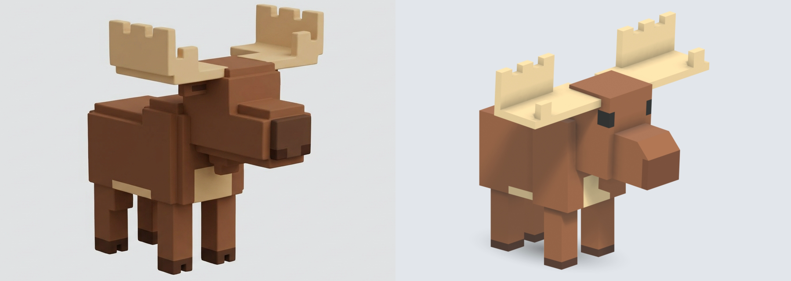

| Part | Grid | Size (W × L × H voxels) | Pivot |
|---|---|---|---|
| Body | main, offset ½ in X (root, R5) | shoulders 11 wide, rump 9; hump falls to the rump through a 2 × 2 wedge | origin |
| Legs ×4 | main, offset ½ in Y | 3 × 3 × 10, 2 buried | hip and shoulder centres on the underside |
| Head | offset ½ in Y and Z | skull and drooping muzzle (2 × 2 wedge), dewlap 2 × 2 × 3, eyes 2 × 2 (head 11 tall) | neck base on the shoulders' front face |
| Antlers ×2 | main, offset ½ in X | flat palms 14 × 7 with a notched back wall | — (rigid with the head) |

**Walk.** 42 frames, diagonal leg pairs ±20°, the body bobbing so the lowest sole always touches the
ground, the head nodding ±6° with the antlers riding on it.

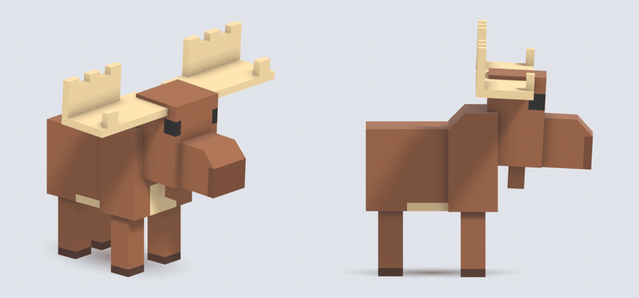

**Taste.**
- **Rump 9 wide under 11-wide shoulders**: the reference's rear legs stand near the body's sides; a
  half-voxel root offset keeps the shoulder step and spreads them.
- **The muzzle wedge is coat-coloured**: the droop is the muzzle top falling forward, so the slope
  continues the top (R7b) and the nose plate reads as a separate face below it.
- **Flat antler palms with 2-voxel notches**: rolled palms read as a reindeer; one-voxel notches
  blurred into a plain wall in the thumbnail.
- **A 3-tall dewlap**: the bell is a moose identifier; at 2 tall it vanished into the chest patch.
- **Square 2 × 2 eyes ahead of the palms**, not the reference's slits — slits read as evil, and the
  palms would shade them.
- **No tail, hoof clefts or nostrils**: none survives the thumbnail; the dark hoof row and the nose
  plate carry the same idea.

### Goose — the detail budget and a fast cycle

A 0.8 m bird scaled up to 2 m to clear its reference's proportions (R3). Seven parts, four colours —
White P00, Pale grey P01 (wings), Orange P44 (beak, feet), Ink P08 (eyes).

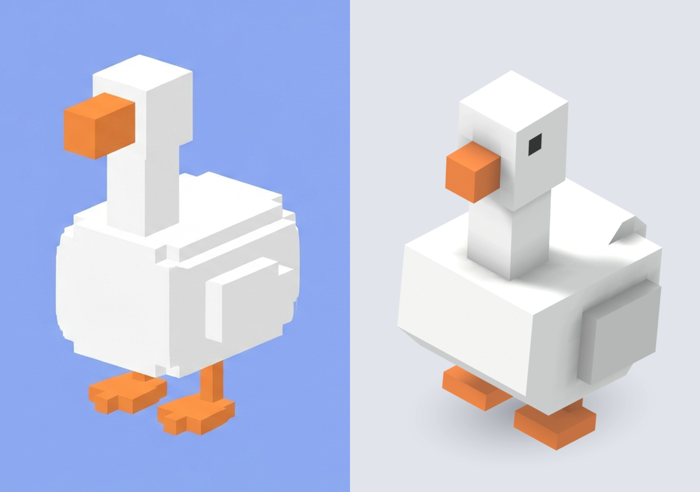

| Part | Grid | Size (W × L × H voxels) | Pivot |
|---|---|---|---|
| Body | main, offset ½ in X (root) | 9 × 10 × 7, 2 × 2 wedges at breast and underside, a tail hump with 1 × 1 bevels | origin; rolls about it |
| Neck | offset ½ in X and Y | 3 × 3 × 8, 2 buried | base of the neck on the body top |
| Head | main | 4 × 4 × 5, square beak 2 × 2 × 2, eyes 1 × 1 | — (rigid with the neck) |
| Wings ×2 | offset ½ in X and Z | 2 × 5 × 4, 1 buried | hinge edge at the shoulder (R16) |
| Legs ×2 | offset ½ in X and Y | 1 × 1 shin on a 3 × 3 foot plate | hip on the underside |

**Waddle.** 21 frames — fast, because it is a small bird (cycle speed). Legs alternate ±20°, the
body rolls ±6° onto the standing leg, the neck pumps twice a step, and each wing flicks once.

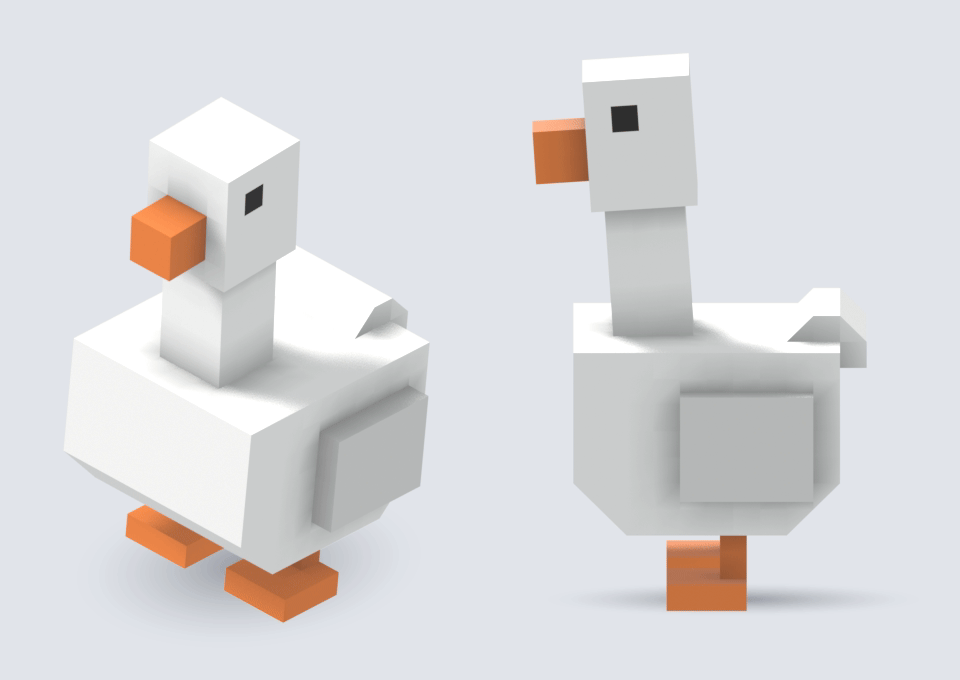

**Taste.**
- **A plain body, no lip**: the reference's inset isn't part of what makes it a goose (Taste calls).
- **A square beak**: the reference's beak is a crisp cube, and it is the bird's one colour accent.
- **Pale grey wings**: white on white disappears; a neighbouring shade keeps a one-voxel-proud wing
  readable (R11).
- **Plain foot plates, no toe notches**: one-voxel notches are under the thumbnail threshold; orange
  plates read as webbed feet.
- **One straight neck pumping twice a step**: the head-pump is the goose's signature and needs only
  one joint.
- **A wing flick, not a flap**: one sharp 12° flick reads as a nervous ruffle.
- **A ±6° roll**: the roll is what makes it a waddle rather than a walk; more tipped it into comedy.
- **1 × 1 square eyes**: slits read as evil (Taste calls).

### Octopus — a pose that overrides its reference, and constant-width limbs

The reference sprawls its tentacles across the ground; the spec stands it up on eight straight
tentacles so it can walk (R3). 25 parts, three colours — Purple P47 (mantle), Plum P48 (tentacles),
Ink P08 (eyes).

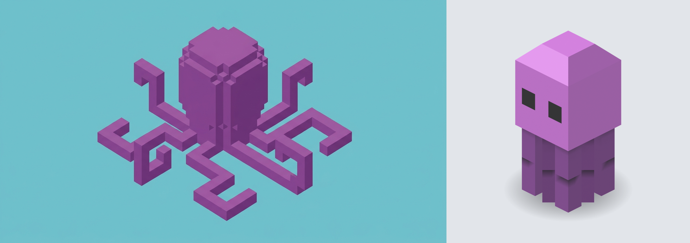

| Part | Grid | Size (W × L × H voxels) | Pivot |
|---|---|---|---|
| Mantle | main (root) | 8 × 8 × 10, crest bevelled by mitred 2 × 2 wedges, eyes 2 × 2 (mantle 10 tall) | origin, centre of the tips |
| Upper segments ×8 | corner tentacles on the main grid; side tentacles turned 45° | 2 × 2 × 5, 1 buried | hip, on the mantle's underside |
| Lower segments ×8 | same turn as the upper | 2 × 2 × 4 | knee, centre of the join |
| Tenons ×8 | half-voxel offset, same turn | 1 × 1 × 2, rigid with the lower | — |

**Crawl.** 20 frames. The corner and side tentacles step in alternating groups, each knee folding
outward to lift the tip and plant it; at each changeover the knees splay and the mantle sinks, and it
sways ±2.5°. Every tentacle is a big mover, so the mantle bakes alone (R24, R25).

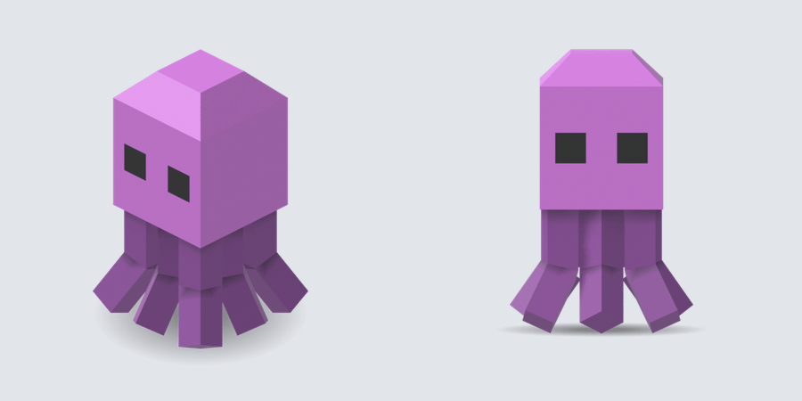

**Taste.**
- **Straight tentacles, not the sprawl**: the sprawl couldn't walk; standing it up keeps the
  reference's mantle, eyes and colour and gives it a gait.
- **Constant 2 × 2 tentacles with a hidden tenon** (R17): an even width reads as one limb; a taper
  read as a stick on a block.
- **Side tentacles turned 45°, not re-hinged**: every tentacle still bends straight outward, so the
  crawl reads the same, while every hinge now runs diagonally to its faces — which is what stopped the
  knees flickering.
- **20 frames, not 21**: divisible by 4, so both groups' crouches and swing peaks land on whole frames
  and the two half-cycles look identical; a touch fast suits a small, skittering animal.
- **Plum tentacles under a Purple mantle**: the reference is one colour, but the darker shade makes the
  arms read as limbs under a head and keeps the gaps between them legible.
- **Tight packing**: an octopus's arms bunch, and opening the spacing would mean thinner or fewer
  tentacles; in motion they always swing apart.
