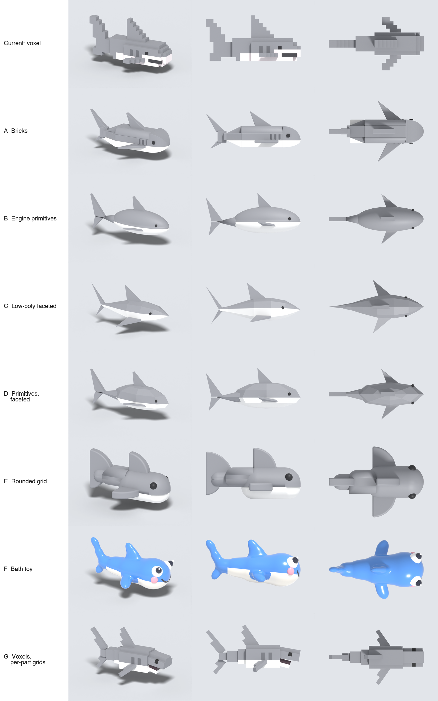

# 0001 — Voxels on per-part grids as the house art style

**Status:** accepted

## Context

Generated models were single-grid voxels. That hid generative flaws well, but every diagonal — fins,
snouts, roofs — came out as a staircase. Seven alternatives were prototyped on the same shark:

## Decision

Keep voxels, but give each part its own grid: whole-voxel dimensions, half-voxel offsets, rotations
in 5° steps. The rules live in
[`Assembler/Assets/docs/VoxelStyle.md`](../../Assembler/Assets/docs/VoxelStyle.md).

## Rejected

- **Bricks** (slope/curve/wedge pieces on a stud grid) — body stays boxy in plan, and every new
  subject wants a bespoke special piece.
- **Engine primitives** (`model` + the nine meshes) — cheapest to ship, but smooth shapes expose
  proportion errors and parts visibly interpenetrate.
- **Low-poly faceted** (lofted cross-sections) — best silhouette, but not modular; needs a lofting
  pipeline.
- **Faceted primitives** (8-sided primitives, flat-shaded) — reads as cobbled together up close.
- **Rounded grid** (whole-unit fillets only) — soft and toy-like, but tapers telescope and every fin
  becomes the same quarter-disc.
- **Bath toy** (metaball vinyl, painted face) — most personality, but no kit; needs a mesher. Its
  face treatment (big eyes, gloss) remains a candidate future layer on top of this style.

## Consequences

- Parts double as animation segments; every articulation rule (seam pivots, embedding, no coplanar
  faces) follows from that.
- The engine's `voxel mesh` renders one grid per asset; a per-part format and engine support are
  follow-up work.
